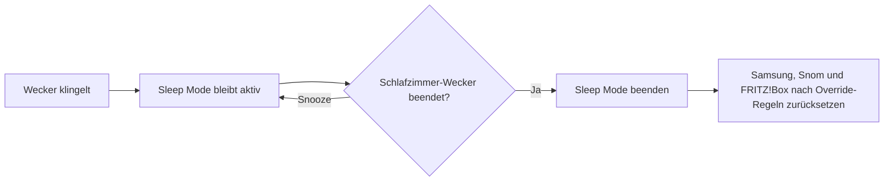
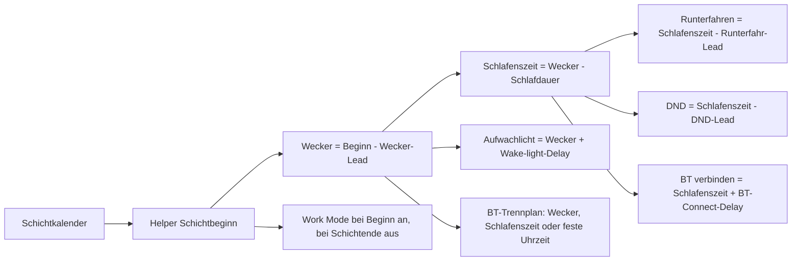
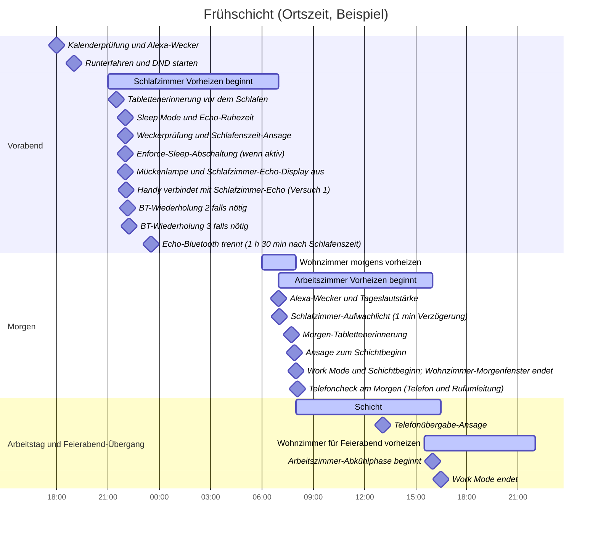

# Home-Assistant-Automationen für Arbeitsschichten

> **Sprache:** Deutsch · [English README](README.md)

Dieses Repository enthält die Home-Assistant-Konfiguration für kalendergesteuerte Arbeitsschichten, Wecker, Smartphone-Modi, Heizungen, Echo-Geräte, Erinnerungen und Licht. Die Helper-Werte werden in der Home-Assistant-Oberfläche gepflegt. Die folgenden Werte entsprechen dem Live-System, geprüft am **28.10.2026**.

## Projektaufbau

- `configuration.yaml` bindet Automationen, Skripte, Templates und Szenen ein.
- `automations.yaml` enthält Schicht-, Heizungs-, Licht-, Anwesenheits- und Geräteautomationen.
- `scripts.yaml` enthält wiederverwendbare Skripte, darunter Wiederholungen für Shelly-TRV-Befehle und Echo-Ansagen.
- `templates.yaml` enthält abgeleitete Status-Entities.
- `dashboards/` enthält geprüfte Lovelace-Kartenfragmente. Das aktive Dashboard verwendet den Home-Assistant-Speichermodus und lädt diese Fragmente nicht automatisch.
- Der [Helper-Namenskatalog](docs/helper-names.md) enthält die GUI-Namen und Zwecke der Helper.

Zugangsdaten, Datenbanken, Backups, Logs und `.storage` sind absichtlich von Git ausgeschlossen. Zugangsdaten gehören in die lokale `secrets.yaml` von Home Assistant.

## Verbeugung vor Hacker Scripts

Mit liebevoller Hochachtung vor [NARKOZ/hacker-scripts](https://github.com/NARKOZ/hacker-scripts) übernimmt dieses Projekt den Automatisierungsgeist fürs Zuhause: Der Kalender plant den Morgen, Echo gibt das Signal, die Heizkörper wärmen die passenden Räume und eine Nachttischlampe wartet genau eine Minute auf ihren dramatischen Auftritt. Ein sehr höflicher Cronjob, nur mit deutlich mehr Heizkörpern.

## Ablauf der Schichtsteuerung

`calendar.shifts` ist die Quelle für geplante Schichten. Einträge können ganztägig sein und sich über mehrere Tage erstrecken. Deshalb fragen die Automationen den konkreten Tag mit `calendar.get_events` ab, statt sich nur auf den aktuellen Kalenderzustand zu verlassen.

Der Arbeitsmodus steht derzeit auf **Automatisch**. An Werktagen steuern konkrete Kalendereinträge `Frühschicht` und `Spätschicht` den Arbeitsmodus des Smartphones und den Schichtablauf. Einträge `Freischicht` und `Support Standby` verwenden die Freischichtzeiten für Wecker, Schlaf-/DND-Zeitplan, Tablettenerinnerungen und Schichtbeginn-Ansage. Die Samsung-Work-Mode-Automation selbst behandelt derzeit nur Früh- und Spätschichten. `4TW-Frei` und `Urlaub` gelten als freie Tage. Samstags und sonntags wird kein Arbeitswecker gestellt. Ein bayerischer Feiertag unterdrückt keine ausdrücklich eingetragene Schicht. Ohne Schichteintrag wird kein Alexa-Wecker gestellt. An einem normalen, nicht anderweitig markierten Werktag kann die Heizung dennoch dem Freischichtplan folgen; Wochenende, freie Kalendertage, Feiertage und Krankmodus haben eigene Heizregeln. Im Modus `Krank` löscht Home Assistant aktive Alexa-Wecker und plant keinen neuen. Außerdem unterdrückt `Krank` kalendergesteuerten Sleep Mode und neue automatische DND-Aktivierungen sowie Work-Mode-Starts und arbeitsbezogene Ansagen. Ein bereits aktiver DND-Zustand wird im Krank-Modus nicht ungefragt abgeschaltet. Manuelle Sleep-Mode- und DND-Steuerung sowie das Krank-Heizprofil bleiben davon unberührt.
Bei jeder Änderung von `input_boolean.work_mode_state` sagen alle Echos an, ob die sofortige Mobilbox-Weiterleitung ein- oder ausgeschaltet werden soll und wie viele Minuten dafür bleiben. Zusätzlich erhält das S25 eine Ja/Nein-Meldung. „Ja“ öffnet den Wähler mit dem passenden Steuercode; dort müssen Arbeits-SIM und Anruf noch bestätigt werden. „Nein“ lässt die Netzeinstellung unverändert. `input_number.work_sim_voicemail_prompt_timeout` steuert sowohl den Ablauf der Meldung als auch die Verzögerung bis zur Folgeansage (aktuell 10 Minuten, 1–30 Minuten in 1-Minuten-Schritten). Danach melden die Echos, dass der Status nicht bestätigt werden kann, und nennen den Prüfcode `*#21#`. Home Assistant kann die MMI-Antwort des Telefonwählers nicht auslesen und behauptet deshalb nicht, die Weiterleitung sei ein- oder ausgeschaltet.
Die Karte „Schichtzeiten & Telefon“ im Dashboard **Home 🏠** bietet außerdem getrennte Aktionen zum manuellen Ein- und Ausschalten der Weiterleitung. Sie ändern den Work Mode nicht, sondern senden eine zeitlich begrenzte Handy-Meldung, die den Wähler erst nach Bestätigung öffnet.

Die wichtigsten Zeitberechnungen lauten:

```text
Wecker           = Schichtbeginn - Wecker-Lead
Schlafenszeit    = Wecker - Schlafdauer
Runterfahren     = Schlafenszeit - Runterfahr-Lead
DND beginnt      = Schlafenszeit - DND-Lead
Morgen-Tabletten = Schichtbeginn - Morgen-Tabletten-Lead
Abend-Tabletten  = Schlafenszeit - Zubettgeh-Lead
BT trennen       = gewählter Plan: Wecker - BT-Alarm-Lead, Schlafenszeit + BT-Sleep-Delay oder feste Uhrzeit
BT verbinden     = Schlafenszeit + BT-Connect-Delay; bei Bedarf bis zum Versuchslimit erneut versuchen
Aufwachlicht     = Wecker + Wake-light-Delay
```

In der Home-Assistant-Oberfläche bedeutet `Lead`, dass ein Ereignis vor dem Bezugspunkt liegt, und `Delay`, dass es danach liegt. Der Helper speichert den Zeitbetrag; die Automation zieht einen Lead ab und addiert einen Delay. Bestehende Entity-IDs enthalten teils weiterhin `_offset`, damit die Automationen kompatibel bleiben; sie sind technische Referenzen und geben nicht die sichtbare Zeitrichtung an. `sick_temp_offset` ist ein Temperaturunterschied und `sleep_duration` eine Dauer.

`input_select.bt_disconnect_mode` bietet drei Pläne: `Zum Wecker` verwendet Weckerzeit minus `bt_disconnect_offset`; `Zum Schlafen` verwendet Schlafenszeit plus `bt_sleep_disconnect_offset_hours`; `Zur Uhrzeit` verwendet täglich `bt_disconnect_time` (Standard 03:00). Die ersten beiden folgen dem Kalender für Frühschicht, Spätschicht und Freischicht/Support Standby; Wochenende, `4TW-Frei`, `Urlaub` und Krankmodus lösen dort keinen kalendergesteuerten Disconnect aus. Die feste Uhrzeit läuft täglich, außer im Krankmodus. Home Assistant weist das Schlafzimmer-Echo an, auf `Local Speaker` umzuschalten. Die HA-App kann eine einzelne gekoppelte Bluetooth-Verbindung nicht direkt trennen und schaltet auch nicht das Bluetooth am Smartphone aus. Nach dem geplanten Verbindungszeitpunkt prüft Home Assistant die ausgewählte Echo-Quelle und wiederholt den Verbindungsversuch bis zur Verbindung oder bis das eingestellte Versuchslimit erreicht ist.

### Sleep Mode und Weckerende

Der Sleep Mode bleibt aktiv, wenn der Alexa-Wecker zur geplanten Zeit zu klingeln beginnt. Er endet erst, wenn der Wecker des Schlafzimmer-Echos beendet wurde; ein Snooze beendet den Sleep Mode nicht. Beim Beenden ruft Home Assistant `script.sleep_mode_end_now` auf. Dadurch werden Samsung Sleep Mode, der interne Status, Snom-DND und die FRITZ!Box-Anrufbeantworter nach denselben Override- und Krank-Regeln wie beim manuellen Beenden zurückgesetzt.

Alexa Media Player liefert ein Ereignis für das Beenden eines Weckers, aber keine verlässliche Angabe dazu, ob der Befehl per Sprache oder in einer App gegeben wurde. Im üblichen Ablauf löst „Alexa, Wecker aus“ die Automation aus; ein anderweitig beendeter Wecker im Schlafzimmer kann sie ebenfalls auslösen. Der Echo-Wecker muss beendet sein und darf nicht nur auf Snooze stehen.





Die Weckerautomation prüft täglich um **18:00** den Kalender für morgen, aktualisiert `calendar.shifts`, fragt morgen mit `calendar.get_events` ab und sendet Alexa einen individuellen Weckerbefehl. Eine Statuskachel zeigt Schicht und geplante Zeiten. Zusätzlich wird vor der Schlafenszeit geprüft, ob der Alexa-Wecker tatsächlich vorhanden ist.

### Dashboard


Der Screenshot zeigt die Live-Ansicht Home vom 28.10.2026. Die Karte „Echo & Licht“ enthält das Auswahlmenü für den Bluetooth-Disconnect sowie Verbindungs- und Wiederholungswerte. Die übrigen Karten gruppieren Overrides, den morgigen Ablauf, Gerätestatus, Sleep Mode und Erinnerungen, Heizprofile sowie Schichtzeiten. In dieser Aufnahme ist „Zum Schlafen“ ausgewählt.

Die DND-Kachel zeigt die globale DND-Anforderung und die einzelnen Geräteschalter. Gedrückthalten eines Schalters für GNOME, Snom oder Samsung S25 setzt dessen Richtlinie auf `Follow global` zurück. Die Echo-Schalter bleiben unabhängig steuerbar.

## Helper und aktuelle Werte

Alle Werte dieser Tabellen lassen sich in Home Assistant ändern. Einstellbereiche und Schritte sind dort ergänzt, wo sie zum Verständnis hilfreich sind. Die Krank-Tablettenerinnerung liegt um `sick_pill_offset` nach dem Freischichtbeginn.

### Schicht- und Uhrzeit-Helper

| Helper | Aktueller Wert | Zweck |
| --- | ---: | --- |
| `input_datetime.early_shift_start` | 08:00 | Beginn der Frühschicht |
| `input_datetime.early_shift_end` | 16:30 | Ende der Frühschicht |
| `input_datetime.late_shift_start` | 09:30 | Beginn der Spätschicht |
| `input_datetime.late_shift_end` | 18:00 | Ende der Spätschicht |
| `input_datetime.free_shift_start` | 09:00 | Startzeit des Freischichtplans |
| `input_datetime.vacation_wake_time` | 09:00 | Aufstehzeit für das Urlaubsprofil |
| `input_datetime.alarm_setup_time` | 18:00 | Tägliche Kalender- und Weckerprüfung für morgen |
| `input_datetime.phone_handover_time` | 13:00 | Zeitpunkt der Telefonübergabe |
| `input_datetime.echo_quiet_time` | 22:00 | Beginn der Echo-Ruhezeit |
| `input_datetime.echo_fallback_time` | 12:00 | Tagsüber-Lautstärke, falls heute kein Wecker geplant ist |

### Relative Zeit-Helper

| Helper | GUI-Name | Aktueller Wert | Bereich / Schritt | Verwendung |
| --- | --- | ---: | --- | --- |
| `input_number.alarm_offset` | Alarm lead | 1 h | 0–3 h / 0,25 h | Wecker vor Schichtbeginn |
| `input_number.sleep_duration` | Sleep duration | 9 h | 6–12 h / 0,25 h | Schlafenszeit relativ zum Wecker |
| `input_number.wind_down_offset` | Wind-down lead | 3 h | 0–6 h / 0,25 h | Ansage zum Runterfahren vor der Schlafenszeit |
| `input_number.dnd_offset` | DND lead | 3 h | 0–4 h / 0,25 h | DND beginnt vor der berechneten Schlafenszeit |
| `input_number.pill_morning_offset` | Meds morning lead | 0,25 h (15 min) | 0–2 h / 0,25 h | Erinnerung vor Schichtbeginn |
| `input_number.pill_bedtime_offset` | Meds evening lead | 0,5 h (30 min) | 0–2 h / 0,25 h | Tablettenerinnerung vor dem Zubettgehen |
| `input_number.sick_pill_offset` | Sick meds delay | 2 h | 0–6 h / 0,25 h | Krank-Tablettenerinnerung nach Freischichtbeginn |
| `input_number.work_sim_voicemail_prompt_timeout` | Work SIM voicemail prompt timeout | 10 min | 1–30 min / 1 min | Zeit für die Mobilbox-Aktion; danach Status-Folgeansage |
| `input_number.phone_handover_offset` | Phone handover delay | 5 min | 0–15 min / 1 min | Verzögerung nach dem Zeitpunkt der Telefonübergabe |
| `input_select.bt_disconnect_mode` | BT disconnect mode | Zum Schlafen | Zum Wecker / Zum Schlafen / Zur Uhrzeit | BT-Trennzeit auswählen |
| `input_number.bt_disconnect_offset` | BT alarm lead | 30 s | 0–120 s / 1 s | Trennung vor dem Wecker bei „Zum Wecker“ |
| `input_number.bt_sleep_disconnect_offset_hours` | BT sleep delay | 1,5 h | 0–6 h / 0,25 h | Trennung nach Schlafenszeit bei „Zum Schlafen“ |
| `input_datetime.bt_disconnect_time` | Fixed disconnect time | 03:00 | Uhrzeit | Feste tägliche Trennzeit bei „Zur Uhrzeit“ |
| `input_number.bt_connect_offset` | BT connect delay | 5 min | 0–20 min / 1 min | Gekoppeltes Smartphone nach der Schlafenszeit verbinden |
| `input_number.bt_connect_retry_interval` | BT connect retry interval | 5 min | 1–30 min / 1 min | Wartezeit zwischen erfolglosen Bluetooth-Verbindungsversuchen |
| `input_number.bt_connect_retry_attempts` | BT connect retry attempts | 3 Versuche | 1–10 / 1 | Gesamtzahl der Verbindungsversuche einschließlich des ersten |

Ein Tabletten-Lead von null bedeutet „jetzt ansagen“ zum geplanten Beginn beziehungsweise zur Schlafenszeit; er deaktiviert die Erinnerung nicht.

### Heizungs-, Echo- und Licht-Helper

| Helper | Aktueller Wert | Bereich / Schritt | Zweck |
| --- | ---: | --- | --- |
| `input_number.whz_target_temp` | 22 °C | 4–31 °C / 1 °C | Komforttemperatur Wohnzimmer |
| `input_number.az_target_temp` | 23 °C | 4–31 °C / 1 °C | Komforttemperatur Arbeitszimmer |
| `input_number.sz_target_temp` | 18 °C | 4–31 °C / 1 °C | Komforttemperatur Schlafzimmer |
| `input_number.heating_min_temp` | 16 °C | 4–18 °C / 0,5 °C | Grundtemperatur außerhalb der Komfortfenster bei geschlossenem Fenster |
| `input_number.window_open_temp` | 4 °C | 4–5 °C / 1 °C | Sollwert bei offenem Fenster; 4 °C bedeutet aus |
| `input_number.heating_preheat_offset` | 1 h | 0–2 h / 0,25 h | Heizvorlauf (Lead) vor einem Planereignis |
| `input_number.heating_cooldown_offset` | 0,5 h | 0–2 h / 0,25 h | Abkühlbeginn (Lead) vor Schichtende |
| `input_number.sick_temp_offset` | 2 °C | 0–5 °C / 0,5 °C | Zusätzlicher Heizaufschlag im Krankmodus |
| `input_number.echo_announcement_volume` | 5 / 10 | 0–10 / 0,1 | Temporäre Lautstärke für Ansagen |
| `input_number.echo_day_volume` | 4 / 10 | 0–10 / 0,5 | Tageslautstärke aller Echo-Geräte |
| `input_number.echo_night_volume` | 3 / 10 | 0–10 / 0,5 | Lautstärke aller Echos während der Ruhezeit |
| `input_number.echo_wake_delay` | 15 s | 0–120 s / 5 s | Verzögerung bis zum Einschalten des Schlafzimmer-Echo-Displays nach Weckerende |
| `input_number.wake_light_delay` | 1 min | 0–10 min / 1 min | Verzögerung nach der berechneten Weckerzeit bis Nachttisch- und Stehlampe angehen |
| `input_number.motion_off_delay` | 2 min | 1–15 min / 1 min | Nachlauf der Bewegungsbeleuchtung |
| `input_number.hallway_light_max_on` | 10 min | 5–120 min / 5 min | Maximale Einschaltdauer als Flurlicht-Sicherheitsabschaltung |

Die vollständige Übersicht der GUI-Namen und Zwecke steht im [Helper-Katalog](docs/helper-names.md). Weitere wichtige Helper:

| Helper | Aktuelle Auswahl | Zweck |
| --- | --- | --- |
| `input_select.work_schedule_mode` | `Automatisch` | `Automatisch`, `Freischicht` oder `Krank` |
| `input_select.whz_sleep_profile` | `Automatisch` | Heizprofil des Wohnzimmers während Sleep Mode |
| `input_select.enforce_sleep_reset_mode` | `Normally On` | Rücksetzregel für den Enforce-Sleep-Schalter |
| `input_select.snom_dnd_policy` | `Follow global` | DND-Richtlinie für Snom: global folgen, erzwingen ein oder erzwingen aus |
| `input_select.samsung_s25_dnd_policy` | `Follow global` | DND-Richtlinie für Samsung S25: global folgen, erzwingen ein oder erzwingen aus |
| `input_text.samsung_work_mode_id` | `104` | Routine-ID des Samsung Work Mode |
| `input_text.samsung_sleep_mode_id` | `100` | Routine-ID des Samsung Sleep Mode |
| `input_text.bt_phone_source` | Gekoppelte Handy-Quelle, lokal eingestellt | Bluetooth-Quelle des Schlafzimmer-Echos |

Boolean-Helper wie `input_boolean.sleep_mode_state`, `input_boolean.work_mode_state`, `input_boolean.dnd_override` und `input_boolean.enforce_sleep` sind Statusmerker oder Dashboard-Schalter. Ihr Zustand ändert sich zur Laufzeit und ist kein Zeitplanwert.

Die einzelne DND-Karte beginnt mit einer nicht interaktiven Statuszeile für die globale DND-Anforderung: Bei aktivem DND ist eine gelbe Glocke zu sehen, andernfalls eine gedämpfte durchgestrichene Glocke, ohne „Ein/Aus“-Text. Darunter trennt eine Linie diese Anzeige von den Geräteschaltern für beide GNOME-Konten, Snom, Samsung und Echo-Geräte. Jede Gerätezeile zeigt den gemeldeten DND-Status als Icon. GNOME-, Snom- und Samsung-Schalter setzen die jeweilige Richtlinie auf „Force on“ oder „Force off“; langes Drücken setzt sie zurück auf „Follow global“. Die GNOME-Agenten melden den tatsächlichen Desktopstatus über Status-Helper zurück. Um den GNOME-Agenten eines Kontos zu aktualisieren, `python3 scripts/update_ha_gnome_dnd_agent.py` aus diesem Repository ausführen, während dieses Konto angemeldet ist. Snom und Samsung werden von Home Assistant anhand ihrer Richtlinien gesteuert und über den abgefragten Geräte- bzw. Companion-App-Status geprüft. Echo-Schalter steuern ihr Echo-DND direkt und bleiben absichtlich unabhängig von der globalen, auf Ruhe vor Menschen ausgerichteten DND-Anforderung. So bleiben Alexa-Ansagen verfügbar. Der separate globale DND-Override synchronisiert Handy- und GNOME-DND, ohne Sleep Mode einzuschalten. Ist `input_boolean.enforce_sleep` an, startet Sleep Mode die vorhandenen Alexa-Routinen „Wohnzimmer aus“ und „Arbeitszimmer aus“, schaltet die übrigen verwalteten Lichter aus und lässt Nachttisch-, Stehlampen- und Flurbeleuchtung an. Die Rücksetzregel wählt `input_select.enforce_sleep_reset_mode`.

## Beispielabläufe

Die Beispiele verwenden die aktuellen Werte oben. Runterfahren und DND beginnen am Vorabend. Zeitberechnungen laufen bei Bedarf über Mitternacht.

| Ereignis | Frühschicht | Spätschicht | Freischicht / Support Standby |
| --- | ---: | ---: | ---: |
| Schichtbeginn / Ende | 08:00–16:30 | 09:30–18:00 | Beginn 09:00; Ende folgt der konfigurierten Schichtdauer |
| Wecker | 07:00 | 08:30 | 08:00 |
| Runterfahransage | 19:00 (Vorabend) | 20:30 (Vorabend) | 20:00 (Vorabend) |
| DND beginnt | 19:00 (Vorabend) | 20:30 (Vorabend) | 20:00 (Vorabend) |
| Schlafenszeit / geplanter Sleep Mode | 22:00 (Vorabend) | 23:30 (Vorabend) | 23:00 (Vorabend) |
| Tablettenerinnerung vor dem Zubettgehen | 21:30 | 23:00 | 22:30 |
| Handy verbindet sich mit Schlafzimmer-Echo | 22:05 | 23:35 | 23:05 |
| Weitere Bluetooth-Versuche bei Bedarf | 22:10, 22:15 | 23:40, 23:45 | 23:10, 23:15 |
| Bluetooth-Disconnect (aktuelle Auswahl) | 23:30 (Vorabend) | 01:00 | 00:30 |
| Schlafzimmer-Aufwachlicht | 07:01 | 08:31 | 08:01 |
| Morgen-Tablettenerinnerung | 07:45 | 09:15 | 08:45 |
| Ansage zum Schichtbeginn | 07:55 | 09:25 | 08:55 |
| Telefoncheck am Morgen | 08:05 (nur Frühschicht) | — | — |
| Telefonübergabe-Check | 13:05 | 13:05 | — |

Im Modus `Krank` richtet sich die Tablettenerinnerung ausschließlich nach `input_datetime.free_shift_start` plus `input_number.sick_pill_offset`: bei den aktuellen Werten 09:00 + 2 h also **11:00 Uhr**. Ein Delay von 0 löst sie genau zum Freischichtbeginn aus. Auch ein Ergebnis nach Mitternacht wird auf die Uhrzeit des Folgetags abgebildet. Dafür ist kein Kalendereintrag erforderlich; es wird kein Arbeitswecker angelegt.

Die Verzögerung für das Aufwachlicht beträgt standardmäßig eine Minute; bei null gehen die Lampen direkt zur berechneten Weckerzeit an. Die Ansage zum Schichtbeginn liegt derzeit fest fünf Minuten vor dem Beginn im YAML. Samsung Work Mode wird bei Früh- und Spätschicht zum Schichtbeginn aktiviert und am konfigurierten Ende deaktiviert. Bei der Frühschicht folgt der morgendliche Telefoncheck fünf Minuten später; bei der Spätschicht gibt es keinen vergleichbaren Check um 09:35. Die Telefonübergabe wird nur bei Früh- und Spätschicht um 13:05 angesagt. An Freischicht- und Support-Standby-Tagen gibt es keine Telefonübergabe-Ansage.

### Gantt-Beispiel: Frühschicht



Die Heizungsbalken gelten, wenn du zuhause bist und die jeweiligen Fenster geschlossen sind. Das Arbeitszimmer heizt von 07:00 bis 16:00; das Wohnzimmer heizt morgens von 06:00 bis 08:00 und ab 15:30 bis zum Sleep Mode um 22:00. Das Schlafzimmer wird von 21:00 bis zum Wecker um 07:00 vorgeheizt. Sleep Mode bleibt während des klingelnden Weckers aktiv und endet nach dem Beenden des Schlafzimmer-Weckers. Danach schaltet das Schlafzimmer-Echo-Display mit seinem separaten `echo_wake_delay` nach 15 Sekunden ein.

## Heizungen und Geräte

- Home Assistant steuert die TRV-Zeitfenster; die alten Shelly-Profil-Automationen sind deaktiviert. Die aktiven Rückkehr- und Wohnzimmer-Sleep-Profile berechnen Sollwerte aus Kalender, Moduswahl, Uhrzeit, Anwesenheit und Fenstersensoren.
- An Schichttagen liegen die Komfortfenster für Wohnzimmer und Arbeitszimmer rund um Schichtbeginn und Schichtende. Das Arbeitszimmer heizt vor Arbeitsbeginn und senkt vor Schichtende ab; das Wohnzimmer wärmt vor dem morgendlichen Übergang und vor Feierabend vor. Die Helper `Preheat lead` und `Cooldown lead` bestimmen diese Fenster.
- Außerhalb der Komfortfenster nutzen Räume bei geschlossenen Fenstern `heating_min_temp`. Ein geöffnetes Fenster setzt den betroffenen TRV auf `window_open_temp` (4 °C). Das Schlafzimmer nutzt während Sleep Mode und im berechneten Vorheizfenster seine Komforttemperatur.
- Am Wochenende und an expliziten `4TW-Frei`-/`Urlaub`-Tagen verwendet das automatische Wohnzimmerprofil die Urlaubs-Aufstehzeit. Das Schlafzimmer bleibt an Sleep Mode gekoppelt. An einem normalen Werktag ohne Kalendereintrag kann die Heizung dem Freischichtprofil folgen, ohne einen Wecker zu stellen; Feiertage sind von diesem Rückfall ausgenommen.
- Im Modus `Krank` löscht die Weckerautomation Alexa-Wecker und stellt keinen neuen; außerdem wird der Krankaufschlag auf die Heizsollwerte addiert. Das Wohnzimmer heizt tagsüber auch bei aktivem Sleep Mode weiter. Kalendergesteuerter Sleep Mode und neue DND-Aktivierungen sowie Work-Mode-Starts und arbeitsbezogene Ansagen werden unterdrückt. Ein bereits aktiver DND-Zustand wird nicht automatisch ausgeschaltet. Manuelle Sleep-Mode- und DND-Steuerung bleiben verfügbar. Die Tablettenerinnerung wird unabhängig vom Kalender bei Freischichtbeginn plus Krank-Delay ausgelöst.
- Shelly-TRV-Befehle laufen über Retry-Skripte, die den Sollwert pollen und den Befehl wiederholen, bis das Gerät den Zielwert meldet. Fenstersensoren wirken auf die Heizentscheidung ein; ein nicht erreichbarer Sensor ist keine Pflichtbedingung.
- Bewegungslicht hält Küche sowie vorderen und hinteren Flur getrennt eingeschaltet, solange Bewegung erkannt wird. Zum zweiminütigen Nachlauf kommt eine zehnminütige Flur-Sicherheitsabschaltung.
- `Home Leave - All` schaltet konfigurierte Lampen und Geräte außerhalb der geschützten Arbeitsumgebung ab. PC, Server und die separat gesteuerten Arbeitszimmer-Kreise sind von dieser Abwesenheitsabschaltung ausgenommen.
- Die Echo-Lautstärke sinkt um 22:00. Beim Alexa-Wecker steigt sie wieder; ohne Wecker für den Tag greift mittags die Fallback-Zeit. Sleep Mode hält das Nachtlautstärkeverhalten aktiv. Ansagen verwenden die eingestellte Ansagelautstärke.
- Nachttisch- und Stehlampe schalten sich mit `wake_light_delay` ein (aktuell eine Minute nach der berechneten Weckerzeit). Separat davon schaltet sich das Schlafzimmer-Echo-Display 15 Sekunden nach dem Beenden des Weckers ein.
- Sleep Mode bittet das Echo im Arbeitszimmer, die Popotan-Steckdose „Mückenlampe“ auszuschalten. Außerhalb von Sleep Mode sendet dasselbe Echo den Einschaltbefehl. Die Steckdose wird über Alexa-Custom-Befehle und nicht über einen nativen Home-Assistant-Schalter gesteuert. Das Display des Schlafzimmer-Echos wird rund um Sleep Mode und beim Home-Assistant-Start ebenfalls per Alexa-Befehl geschaltet.
- Fehlgeschlagene Backups melden sich über Telegram.

## Umsetzungshinweis

Die Krank-Tablettenerinnerung liest `input_number.sick_pill_offset` und verwendet `input_datetime.free_shift_start` als Zeitbasis. Die zuvor vorhandenen Abweichungen – falsche Helper-ID und Spätschicht als Referenz – sind in der Repository-Konfiguration korrigiert.

## Prüfung und Vibe-Coding-Hinweis

YAML-Änderungen sollten vor dem Neuladen mit der Home-Assistant-Konfigurationsprüfung validiert werden. Änderungen an Live-Geräten sollten außerdem anhand des HA-Zustands und des physischen Geräts geprüft werden.

**Vibe-Coding-Hinweis:** Dieses Projekt wurde schrittweise mit KI-gestütztem Programmieren und menschlicher Steuerung entwickelt. Generiertes YAML und Erklärungen können weiterhin Fehler enthalten. Änderungen prüfen, die Home-Assistant-Konfiguration validieren und Geräteverhalten kontrollieren, bevor man sich auf neue Automationen verlässt. Dieses Repository ist eine persönliche Konfiguration und kein allgemeines Home-Assistant-Paket.
