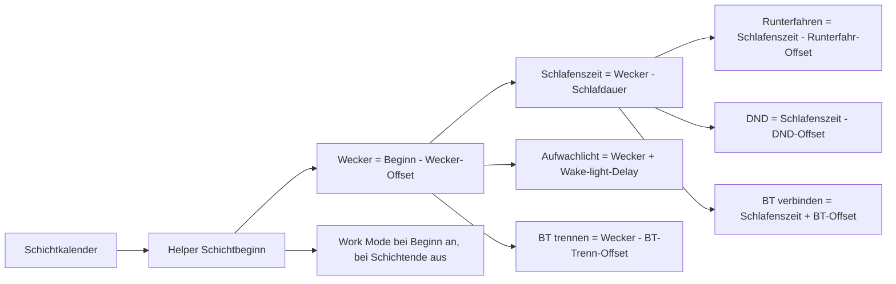
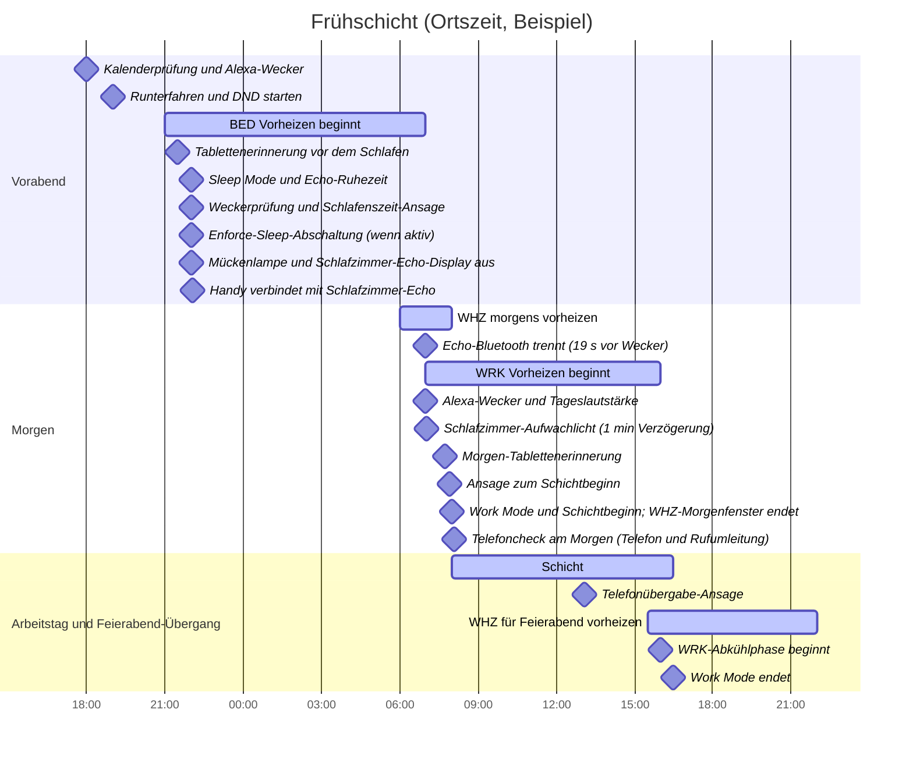

# Home-Assistant-Automationen für Arbeitsschichten

> **Sprache:** Deutsch · [English README](README.md)

Dieses Repository enthält die Home-Assistant-Konfiguration für kalendergesteuerte Arbeitsschichten, Wecker, Smartphone-Modi, Heizungen, Echo-Geräte, Erinnerungen und Licht. Die Helper-Werte werden in der Home-Assistant-Oberfläche gepflegt. Die folgenden Werte entsprechen dem Live-System, geprüft am **27.10.2026**.

## Projektaufbau

- `configuration.yaml` bindet Automationen, Skripte, Templates und Szenen ein.
- `automations.yaml` enthält Schicht-, Heizungs-, Licht-, Anwesenheits- und Geräteautomationen.
- `scripts.yaml` enthält wiederverwendbare Skripte, darunter Wiederholungen für Shelly-TRV-Befehle und Echo-Ansagen.
- `templates.yaml` enthält abgeleitete Status-Entities.
- `dashboards/` enthält geprüfte Lovelace-Kartenfragmente. Das aktive Dashboard verwendet den Home-Assistant-Speichermodus und lädt diese Fragmente nicht automatisch.
- Der [Helper-Namenskatalog](docs/helper-names.md) enthält die GUI-Namen und Zwecke der Helper.

Zugangsdaten, Datenbanken, Backups, Logs und `.storage` sind absichtlich von Git ausgeschlossen. Zugangsdaten gehören in die lokale `secrets.yaml` von Home Assistant.

## Verbeugung vor Hacker Scripts

Mit liebevoller Hochachtung vor [NARKOZ/hacker-scripts](https://github.com/NARKOZ/hacker-scripts) übernimmt dieses Projekt den Automatisierungsgeist fürs Zuhause: Der Kalender plant den Morgen, Echo gibt das Signal, die Heizkörper wärmen die passenden Räume und eine Nachttischlampe wartet genau eine Minute auf ihren dramatischen Auftritt. Ein sehr höflicher Cronjob, nur mit deutlich mehr Heizkörpern.

## Ablauf der Schichtsteuerung

`calendar.shifts` ist die Quelle für geplante Schichten. Einträge können ganztägig sein und sich über mehrere Tage erstrecken. Deshalb fragen die Automationen den konkreten Tag mit `calendar.get_events` ab, statt sich nur auf den aktuellen Kalenderzustand zu verlassen.

Der Arbeitsmodus steht derzeit auf **Automatisch**. An Werktagen steuern konkrete Kalendereinträge `Frühschicht` und `Spätschicht` den Arbeitsmodus des Smartphones und den Schichtablauf. Einträge `Freischicht` und `Support Standby` verwenden die Freischichtzeiten für Wecker, Schlaf-/DND-Zeitplan, Tablettenerinnerungen und Schichtbeginn-Ansage. Die Samsung-Work-Mode-Automation selbst behandelt derzeit nur Früh- und Spätschichten. `4TW-Frei` und `Urlaub` gelten als freie Tage. Samstags und sonntags wird kein Arbeitswecker gestellt. Ein bayerischer Feiertag unterdrückt keine ausdrücklich eingetragene Schicht. Ohne Schichteintrag wird kein Alexa-Wecker gestellt. An einem normalen, nicht anderweitig markierten Werktag kann die Heizung dennoch dem Freischichtplan folgen; Wochenende, freie Kalendertage, Feiertage und Krankmodus haben eigene Heizregeln. Im Modus `Krank` löscht Home Assistant aktive Alexa-Wecker und plant keinen neuen.

Die wichtigsten Zeitberechnungen lauten:

```text
Wecker           = Schichtbeginn - Wecker-Offset
Schlafenszeit    = Wecker - Schlafdauer
Runterfahren     = Schlafenszeit - Runterfahr-Offset
DND beginnt     = Schlafenszeit - DND-Offset
Morgen-Tabletten = Schichtbeginn - Morgen-Tabletten-Offset
Abend-Tabletten = Schlafenszeit - Zubettgeh-Tabletten-Offset
BT trennen       = Wecker - BT-Trenn-Offset
BT verbinden     = Schlafenszeit + BT-Verbindungs-Offset
Aufwachlicht     = Wecker + Wake-light-Delay
```

Die Bluetooth-Verbindung wählt das gekoppelte Smartphone als Quelle des Schlafzimmer-Echos aus. Bluetooth am Smartphone wird nicht ausgeschaltet. Die geplante Verbindung erfolgt nach der Schlafenszeit; bei manuellem Einschalten des Sleep Mode gibt es ebenfalls einen Verbindungsversuch als Rückfall.



Die Weckerautomation prüft täglich um **18:00** den Kalender für morgen, aktualisiert `calendar.shifts`, fragt morgen mit `calendar.get_events` ab und sendet Alexa einen individuellen Weckerbefehl. Eine Statuskachel zeigt Schicht und geplante Zeiten. Zusätzlich wird vor der Schlafenszeit geprüft, ob der Alexa-Wecker tatsächlich vorhanden ist.

## Helper und aktuelle Werte

Alle Werte dieser Tabellen lassen sich in Home Assistant ändern. Einstellbereiche und Schritte sind dort ergänzt, wo sie zum Verständnis hilfreich sind. Der Hinweis zum `sick_pill_offset` beschreibt einen aktuellen Verweisfehler zwischen Helper und YAML.

### Schicht- und Uhrzeit-Helper

| Helper | Aktueller Wert | Zweck |
| --- | ---: | --- |
| `input_datetime.early_shift_start` | 08:00 | Beginn der Frühschicht |
| `input_datetime.early_shift_end` | 16:30 | Ende der Frühschicht |
| `input_datetime.late_shift_start` | 09:30 | Beginn der Spätschicht |
| `input_datetime.late_shift_end` | 18:00 | Ende der Spätschicht |
| `input_datetime.free_shift_start` | 09:00 | Startzeit des Freischichtplans |
| `input_datetime.vacation_wake_time` | 09:00 | Aufstehzeit für das Urlaubsprofil |
| `input_datetime.alarm_setup_time` | 18:00 | Tägliche Kalender- und Weckerprüfung für morgen |
| `input_datetime.phone_handover_time` | 13:00 | Zeitpunkt der Telefonübergabe |
| `input_datetime.echo_quiet_time` | 22:00 | Beginn der Echo-Ruhezeit |
| `input_datetime.echo_fallback_time` | 12:00 | Tagsüber-Lautstärke, falls heute kein Wecker geplant ist |

### Relative Offsets

| Helper | Aktueller Wert | Bereich / Schritt | Verwendung |
| --- | ---: | --- | --- |
| `input_number.alarm_offset` | 1 h | 0–3 h / 0,25 h | Wecker vor Schichtbeginn |
| `input_number.sleep_duration` | 9 h | 6–12 h / 0,25 h | Schlafenszeit relativ zum Wecker |
| `input_number.wind_down_offset` | 3 h | 0–6 h / 0,25 h | Ansage zum Runterfahren vor der Schlafenszeit |
| `input_number.dnd_offset` | 3 h | 0–4 h / 0,25 h | DND beginnt vor der berechneten Schlafenszeit |
| `input_number.pill_morning_offset` | 0,25 h (15 min) | 0–2 h / 0,25 h | Erinnerung vor Schichtbeginn |
| `input_number.pill_bedtime_offset` | 0,5 h (30 min) | 0–2 h / 0,25 h | Tablettenerinnerung vor dem Zubettgehen |
| `input_number.sick_pill_offset` | 2 h | 0–6 h / 0,25 h | Vorgesehener Krank-Offset für Tabletten; siehe Hinweis unten |
| `input_number.phone_handover_offset` | 5 min | 0–15 min / 1 min | Verzögerung vor Telefonansagen |
| `input_number.bt_disconnect_offset` | 19 s | 0–120 s / 1 s | Echo-Bluetooth vor dem Wecker trennen |
| `input_number.bt_connect_offset` | 5 min | 0–20 min / 1 min | Gekoppeltes Smartphone nach der Schlafenszeit verbinden |

Ein Tabletten-Offset von null bedeutet „jetzt ansagen“ zum geplanten Beginn beziehungsweise zur Schlafenszeit; er deaktiviert die Erinnerung nicht.

### Heizungs-, Echo- und Licht-Helper

| Helper | Aktueller Wert | Bereich / Schritt | Zweck |
| --- | ---: | --- | --- |
| `input_number.whz_target_temp` | 22 °C | 4–31 °C / 1 °C | Komforttemperatur Wohnzimmer |
| `input_number.az_target_temp` | 23 °C | 4–31 °C / 1 °C | Komforttemperatur Arbeitszimmer (`WRK`) |
| `input_number.sz_target_temp` | 18 °C | 4–31 °C / 1 °C | Komforttemperatur Schlafzimmer (`BED`) |
| `input_number.heating_min_temp` | 16 °C | 4–18 °C / 0,5 °C | Grundtemperatur außerhalb der Komfortfenster bei geschlossenem Fenster |
| `input_number.window_open_temp` | 4 °C | 4–5 °C / 1 °C | Sollwert bei offenem Fenster; 4 °C bedeutet aus |
| `input_number.heating_preheat_offset` | 1 h | 0–2 h / 0,25 h | Heizvorlauf vor einem Planereignis |
| `input_number.heating_cooldown_offset` | 0,5 h | 0–2 h / 0,25 h | Vorzeitiges Absenken vor Schichtende |
| `input_number.sick_temp_offset` | 2 °C | 0–5 °C / 0,5 °C | Zusätzlicher Heizaufschlag im Krankmodus |
| `input_number.echo_announcement_volume` | 5 / 10 | 0–10 / 0,1 | Temporäre Lautstärke für Ansagen |
| `input_number.echo_day_volume` | 4 / 10 | 0–10 / 0,5 | Tageslautstärke aller Echo-Geräte |
| `input_number.echo_night_volume` | 3 / 10 | 0–10 / 0,5 | Lautstärke aller Echos während der Ruhezeit |
| `input_number.echo_wake_delay` | 15 s | 0–120 s / 5 s | Verzögerung bis zum Einschalten des Schlafzimmer-Echo-Displays nach Weckerende |
| `input_number.wake_light_delay` | 1 min | 0–10 min / 1 min | Verzögerung nach der berechneten Weckerzeit bis Nachttisch- und Stehlampe angehen |
| `input_number.motion_off_delay` | 2 min | 1–15 min / 1 min | Nachlauf der Bewegungsbeleuchtung |
| `input_number.hallway_light_max_on` | 10 min | 5–120 min / 5 min | Maximale Einschaltdauer als Flurlicht-Sicherheitsabschaltung |

Die vollständige Übersicht der GUI-Namen und Zwecke steht im [Helper-Katalog](docs/helper-names.md). Weitere wichtige Helper:

| Helper | Aktuelle Auswahl | Zweck |
| --- | --- | --- |
| `input_select.work_schedule_mode` | `Automatisch` | `Automatisch`, `Freischicht` oder `Krank` |
| `input_select.whz_sleep_profile` | `Automatisch` | Heizprofil des Wohnzimmers während Sleep Mode |
| `input_select.enforce_sleep_reset_mode` | `Normally On` | Rücksetzregel für den Enforce-Sleep-Schalter |
| `input_text.samsung_work_mode_id` | `104` | Routine-ID des Samsung Work Mode |
| `input_text.samsung_sleep_mode_id` | `100` | Routine-ID des Samsung Sleep Mode |
| `input_text.bt_phone_source` | Gekoppelte Handy-Quelle, lokal eingestellt | Bluetooth-Quelle des Schlafzimmer-Echos |

Boolean-Helper wie `input_boolean.sleep_mode_state`, `input_boolean.work_mode_state`, `input_boolean.dnd_override` und `input_boolean.enforce_sleep` sind Statusmerker oder Dashboard-Schalter. Ihr Zustand ändert sich zur Laufzeit und ist kein Zeitplanwert.

Der Sleep-Mode-Schalter im Dashboard verwendet dieselbe Aktivierungs- und Abschaltsequenz wie der Zeitplan: Samsung Sleep Mode, Snom-DND und beide FRITZ!Box-Anrufbeantworter werden gemeinsam gesteuert. Der separate DND-Override synchronisiert außerdem Handy- und GNOME-DND, ohne Sleep Mode einzuschalten. Ist `input_boolean.enforce_sleep` an, startet Sleep Mode die vorhandenen Alexa-Routinen „Wohnzimmer aus“ und „Arbeitszimmer aus“, schaltet die übrigen verwalteten Lichter aus und lässt Nachttisch-, Stehlampen- und Flurbeleuchtung an. Die Rücksetzregel wählt `input_select.enforce_sleep_reset_mode`.

## Beispielabläufe

Die Beispiele verwenden die aktuellen Werte oben. Runterfahren und DND beginnen am Vorabend. Zeitberechnungen laufen bei Bedarf über Mitternacht.

| Ereignis | Frühschicht | Spätschicht | Freischicht / Support Standby |
| --- | ---: | ---: | ---: |
| Schichtbeginn / Ende | 08:00–16:30 | 09:30–18:00 | Beginn 09:00; Ende folgt der konfigurierten Schichtdauer |
| Wecker | 07:00 | 08:30 | 08:00 |
| Runterfahransage | 19:00 (Vorabend) | 20:30 (Vorabend) | 20:00 (Vorabend) |
| DND beginnt | 19:00 (Vorabend) | 20:30 (Vorabend) | 20:00 (Vorabend) |
| Schlafenszeit / geplanter Sleep Mode | 22:00 (Vorabend) | 23:30 (Vorabend) | 23:00 (Vorabend) |
| Tablettenerinnerung vor dem Zubettgehen | 21:30 | 23:00 | 22:30 |
| Handy verbindet sich mit Schlafzimmer-Echo | 22:05 | 23:35 | 23:05 |
| Bluetooth trennt vor dem Wecker | 06:59:41 | 08:29:41 | 07:59:41 |
| Schlafzimmer-Aufwachlicht | 07:01 | 08:31 | 08:01 |
| Morgen-Tablettenerinnerung | 07:45 | 09:15 | 08:45 |
| Ansage zum Schichtbeginn | 07:55 | 09:25 | 08:55 |
| Telefoncheck am Morgen | 08:05 (nur Frühschicht) | — | — |
| Telefonübergabe-Check | 13:05 | 13:05 | — |

Die Verzögerung für das Aufwachlicht beträgt standardmäßig eine Minute; bei null gehen die Lampen direkt zur berechneten Weckerzeit an. Die Ansage zum Schichtbeginn liegt derzeit fest fünf Minuten vor dem Beginn im YAML. Samsung Work Mode wird bei Früh- und Spätschicht zum Schichtbeginn aktiviert und am konfigurierten Ende deaktiviert. Bei der Frühschicht folgt der morgendliche Telefoncheck fünf Minuten später; bei der Spätschicht gibt es keinen vergleichbaren Check um 09:35. Die Telefonübergabe wird bei beiden Schichten um 13:05 angesagt.

### Gantt-Beispiel: Frühschicht



Die Heizungsbalken gelten, wenn du zuhause bist und die jeweiligen Fenster geschlossen sind. WRK heizt von 07:00 bis 16:00; WHZ heizt morgens von 06:00 bis 08:00 und ab 15:30 bis zum Sleep Mode um 22:00. BED wird von 21:00 bis zum Wecker um 07:00 vorgeheizt. Nach dem Beenden des Weckers schaltet das Schlafzimmer-Echo-Display mit seinem separaten `echo_wake_delay` nach 15 Sekunden ein.

## Heizungen und Geräte

- Home Assistant steuert die TRV-Zeitfenster; die alten Shelly-Profil-Automationen sind deaktiviert. Die aktiven Rückkehr- und Wohnzimmer-Sleep-Profile berechnen Sollwerte aus Kalender, Moduswahl, Uhrzeit, Anwesenheit und Fenstersensoren.
- An Schichttagen liegen die Komfortfenster für Wohnzimmer und Arbeitszimmer rund um Schichtbeginn und Schichtende. Das Arbeitszimmer heizt vor Arbeitsbeginn und senkt vor Schichtende ab; das Wohnzimmer wärmt vor dem morgendlichen Übergang und vor Feierabend vor. `heating_preheat_offset` und `heating_cooldown_offset` bestimmen diese Fenster.
- Außerhalb der Komfortfenster nutzen Räume bei geschlossenen Fenstern `heating_min_temp`. Ein geöffnetes Fenster setzt den betroffenen TRV auf `window_open_temp` (4 °C). Das Schlafzimmer nutzt während Sleep Mode und im berechneten Vorheizfenster seine Komforttemperatur.
- Am Wochenende und an expliziten `4TW-Frei`-/`Urlaub`-Tagen verwendet das automatische Wohnzimmerprofil die Urlaubs-Aufstehzeit. Das Schlafzimmer bleibt an Sleep Mode gekoppelt. An einem normalen Werktag ohne Kalendereintrag kann die Heizung dem Freischichtprofil folgen, ohne einen Wecker zu stellen; Feiertage sind von diesem Rückfall ausgenommen.
- Im Modus `Krank` löscht die Weckerautomation Alexa-Wecker und stellt keinen neuen; außerdem wird der Krankaufschlag auf die Heizsollwerte addiert. Das Wohnzimmer heizt tagsüber auch bei aktivem Sleep Mode weiter. Ein bekannter Widerspruch: Die Kalenderautomation für Sleep/DND prüft weiterhin den Schichteintrag, aber ihre Einschaltaktionen nicht auf den Modus `Krank`. Bei einem expliziten Schichteintrag können daher Sleep Mode und DND weiterhin automatisch eingeschaltet werden. Vorgesehen ist im Krankmodus ein manueller Sleep Mode ohne automatischen Schlaf-/DND-Rhythmus.
- Shelly-TRV-Befehle laufen über Retry-Skripte, die den Sollwert pollen und den Befehl wiederholen, bis das Gerät den Zielwert meldet. Fenstersensoren wirken auf die Heizentscheidung ein; ein nicht erreichbarer Sensor ist keine Pflichtbedingung.
- Bewegungslicht hält Küche sowie vorderen und hinteren Flur getrennt eingeschaltet, solange Bewegung erkannt wird. Zum zweiminütigen Nachlauf kommt eine zehnminütige Flur-Sicherheitsabschaltung.
- `Home Leave - All` schaltet konfigurierte Lampen und Geräte außerhalb der geschützten Arbeitsumgebung ab. PC, Server und die separat gesteuerten Arbeitszimmer-Kreise sind von dieser Abwesenheitsabschaltung ausgenommen.
- Die Echo-Lautstärke sinkt um 22:00. Beim Alexa-Wecker steigt sie wieder; ohne Wecker für den Tag greift mittags die Fallback-Zeit. Sleep Mode hält das Nachtlautstärkeverhalten aktiv. Ansagen verwenden die eingestellte Ansagelautstärke.
- Nachttisch- und Stehlampe schalten sich mit `wake_light_delay` ein (aktuell eine Minute nach der berechneten Weckerzeit). Separat davon schaltet sich das Schlafzimmer-Echo-Display 15 Sekunden nach dem Beenden des Weckers ein.
- Sleep Mode bittet das Echo im Arbeitszimmer, die Popotan-Steckdose „Mückenlampe“ auszuschalten. Außerhalb von Sleep Mode sendet dasselbe Echo den Einschaltbefehl. Die Steckdose wird über Alexa-Custom-Befehle und nicht über einen nativen Home-Assistant-Schalter gesteuert. Das Display des Schlafzimmer-Echos wird rund um Sleep Mode und beim Home-Assistant-Start ebenfalls per Alexa-Befehl geschaltet.
- Fehlgeschlagene Backups melden sich über Telegram.

## Aktueller Umsetzungshinweis

Der Live-Helper `input_number.sick_pill_offset` steht auf 2 Stunden. Die Krank-Tablettenautomation liest noch die alte Entity-ID `input_number.sick_temp_offset_tablettenerinnerung`, die im Helper-Register nicht existiert. Deshalb greift der YAML-Fallback von 2 Stunden, statt den aktuellen Helper auszulesen. Diese README hält den Fehler fest; sie ändert die Automation nicht.

## Prüfung und Vibe-Coding-Hinweis

YAML-Änderungen sollten vor dem Neuladen mit der Home-Assistant-Konfigurationsprüfung validiert werden. Änderungen an Live-Geräten sollten außerdem anhand des HA-Zustands und des physischen Geräts geprüft werden.

**Vibe-Coding-Hinweis:** Dieses Projekt wurde schrittweise mit KI-gestütztem Programmieren und menschlicher Steuerung entwickelt. Generiertes YAML und Erklärungen können weiterhin Fehler enthalten. Änderungen prüfen, die Home-Assistant-Konfiguration validieren und Geräteverhalten kontrollieren, bevor man sich auf neue Automationen verlässt. Dieses Repository ist eine persönliche Konfiguration und kein allgemeines Home-Assistant-Paket.
