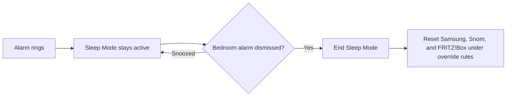
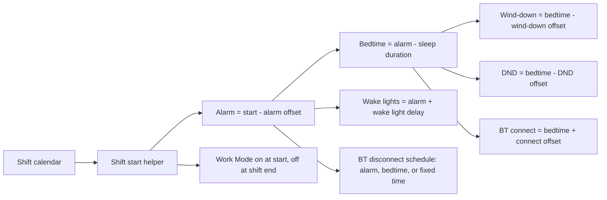
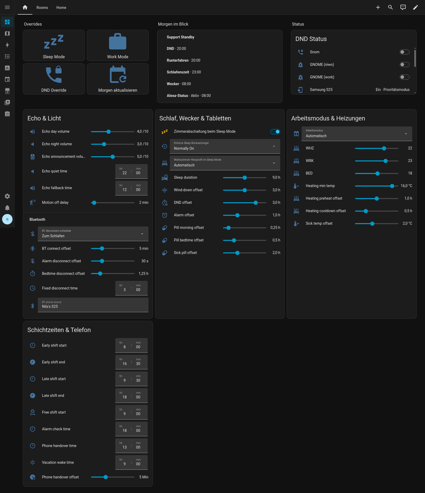
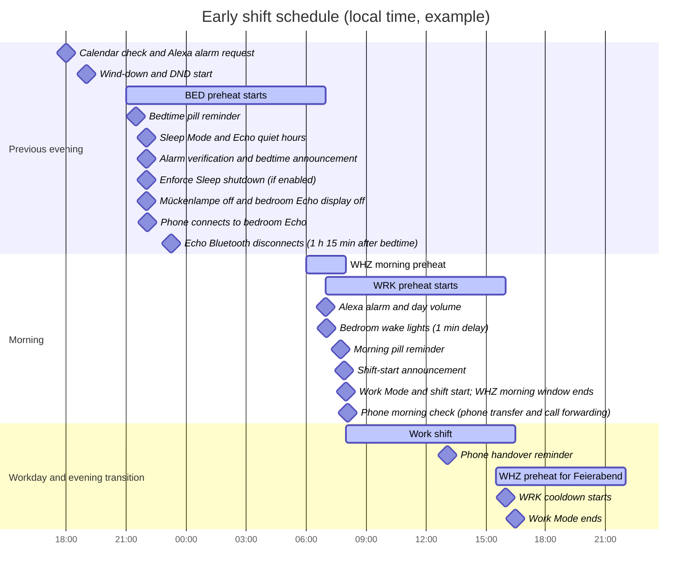

# Home Assistant shift automation

> **Language:** English · [Deutsche Version](README.de.md)

This repository contains the Home Assistant configuration for calendar-based work shifts, alarms, phone modes, heating, Echo devices, reminders, and lighting. Helper values are edited in the Home Assistant UI; the values below are a snapshot of the live instance checked on **2026-10-28**.

## Project layout

- `configuration.yaml` includes the automation, script, template, and scene files.
- `automations.yaml` contains the shift, heating, lighting, presence, and device automations.
- `scripts.yaml` contains reusable scripts, including retrying Shelly TRV commands and Echo announcements.
- `templates.yaml` contains derived status entities.
- `dashboards/` contains reviewed Lovelace card fragments. The live dashboard uses Home Assistant storage mode, so these fragments are not loaded automatically.
- [Helper names](docs/helper-names.md) lists the GUI labels and purposes of the helpers.

Credentials, databases, backups, logs, and `.storage` are intentionally excluded from Git. Keep credentials in Home Assistant's local `secrets.yaml`.

## A respectful nod to Hacker Scripts

With affectionate admiration for [NARKOZ/hacker-scripts](https://github.com/NARKOZ/hacker-scripts), this project brings that automation-first spirit home: the calendar plans the morning, Echo gives the cue, the TRVs warm the right rooms, and a bedside lamp waits one minute before making its dramatic entrance. A very polite cron job, with considerably more radiators.

## How the schedule works

`calendar.shifts` is the source of truth for scheduled shifts. Calendar events may be all-day or span multiple days, so the automations query the relevant date with `calendar.get_events` instead of relying only on the current calendar state.

The work schedule mode is currently **Automatisch**. On weekdays, explicit `Frühschicht` and `Spätschicht` events drive the work-phone mode and shift schedule. Explicit `Freischicht` and `Support Standby` events use the free-shift clock for the alarm, sleep/DND schedule, pill reminders, and shift-start announcement; the Samsung Work Mode automation itself currently handles only early and late shifts. `4TW-Frei` and `Urlaub` are days off. Saturdays and Sundays never get a work alarm. A Bavarian public holiday does not suppress a shift that is explicitly present in the shift calendar. With no shift event, no Alexa alarm is set. An ordinary unmarked weekday may use the free-shift heating schedule, but weekends, marked days off, public holidays, and sick mode follow their own heating rules. In `Krank` mode, Home Assistant cancels active Alexa alarms and does not schedule a new one. It also suppresses calendar-driven Sleep Mode and new automatic DND activations, Work Mode starts, and work-related announcements. An existing DND state is not turned off automatically. Manual Sleep Mode and DND controls and the sick heating profile remain available.

The main time calculations are:

```text
alarm time       = shift start - alarm offset
bedtime          = alarm time - sleep duration
wind-down        = bedtime - wind-down offset
DND starts       = bedtime - DND offset
morning pills    = shift start - morning pill offset
bedtime pills    = bedtime - bedtime pill offset
BT disconnect    = selected schedule: alarm - offset, bedtime + offset, or fixed time
BT connection    = bedtime + BT connect offset
wake lights      = alarm time + wake light delay
```

`input_select.bt_disconnect_mode` offers three schedules: `Zum Wecker` uses alarm time minus `bt_disconnect_offset`; `Zum Schlafen` uses bedtime plus `bt_sleep_disconnect_offset_hours`; `Zur Uhrzeit` uses the daily `bt_disconnect_time` (default 03:00). The first two follow the calendar for early, late, and free shifts/Support Standby; weekends, `4TW-Frei`, `Urlaub`, and Sick mode do not trigger those calendar-based disconnects. The fixed-time option runs daily except in Sick mode. Home Assistant tells the bedroom Echo to switch to `Local Speaker`. The HA app cannot directly disconnect one paired Bluetooth device and does not switch Bluetooth off on the phone.

### Sleep Mode and alarm dismissal

Sleep Mode stays active when the Alexa alarm starts ringing at its scheduled time. It ends only after the bedroom Echo alarm is dismissed; snoozing does not end Sleep Mode. Home Assistant then calls `script.sleep_mode_end_now`, which resets Samsung Sleep Mode, its internal state, Snom DND, and the FRITZ!Box answering machines under the same override and sick-mode rules as manual shutdown.

Alexa Media Player reports that an alarm was dismissed, but does not reliably identify whether dismissal came from a voice command or an app. In the normal flow, “Alexa, stop the alarm” triggers this automation; dismissing the bedroom alarm another way can also trigger it. The alarm must be dismissed, not snoozed.





The next-day alarm automation checks the calendar daily at **18:00**, refreshes `calendar.shifts`, queries tomorrow with `calendar.get_events`, and sends Alexa a custom alarm command. A separate status panel reports the shift and planned times. The status/alarm check also verifies that the Alexa alarm exists before bedtime.

### Dashboard



This screenshot shows the live Home view on 2026-10-28. The Echo & Light card contains the Bluetooth disconnect selector and its alarm, bedtime, and fixed-time settings. The other cards group overrides, tomorrow's schedule, device status, Sleep Mode and reminders, heating profiles, and shift times. In this capture, the selected Bluetooth plan is `Zum Schlafen`.

## Helpers and current values

All values in these tables are editable in Home Assistant. Ranges and steps are included where they are useful for understanding a setting. The sick-mode pill reminder is scheduled relative to the free-shift start using `sick_pill_offset`.

### Shift and clock helpers

| Helper | Current value | Purpose |
| --- | ---: | --- |
| `input_datetime.early_shift_start` | 08:00 | Early shift starts |
| `input_datetime.early_shift_end` | 16:30 | Early shift ends |
| `input_datetime.late_shift_start` | 09:30 | Late shift starts |
| `input_datetime.late_shift_end` | 18:00 | Late shift ends |
| `input_datetime.free_shift_start` | 09:00 | Start used by the free-shift schedule |
| `input_datetime.vacation_wake_time` | 09:00 | Wake time for the vacation profile |
| `input_datetime.alarm_setup_time` | 18:00 | Daily check for tomorrow's calendar and alarm |
| `input_datetime.phone_handover_time` | 13:00 | Phone handover reminder time |
| `input_datetime.echo_quiet_time` | 22:00 | Start of Echo quiet hours |
| `input_datetime.echo_fallback_time` | 12:00 | Restore daytime Echo volume if no alarm is scheduled today |

### Relative offsets

| Helper | Current value | Range / step | Used for |
| --- | ---: | --- | --- |
| `input_number.alarm_offset` | 1 h | 0–3 h / 0.25 h | Alarm before shift start |
| `input_number.sleep_duration` | 9 h | 6–12 h / 0.25 h | Bedtime relative to the alarm |
| `input_number.wind_down_offset` | 3 h | 0–6 h / 0.25 h | Wind-down announcement before bedtime |
| `input_number.dnd_offset` | 3 h | 0–4 h / 0.25 h | DND starts before calculated bedtime |
| `input_number.pill_morning_offset` | 0.25 h (15 min) | 0–2 h / 0.25 h | Morning pill reminder before shift start |
| `input_number.pill_bedtime_offset` | 0.5 h (30 min) | 0–2 h / 0.25 h | Bedtime pill reminder |
| `input_number.sick_pill_offset` | 2 h | 0–6 h / 0.25 h | Sick-mode pill reminder after free-shift start |
| `input_number.phone_handover_offset` | 5 min | 0–15 min / 1 min | Delay before phone handover announcements |
| `input_select.bt_disconnect_mode` | Zum Schlafen | Zum Wecker / Zum Schlafen / Zur Uhrzeit | Choose the BT disconnect schedule |
| `input_number.bt_disconnect_offset` | 30 s | 0–120 s / 1 s | Lead before alarm for `Zum Wecker` |
| `input_number.bt_sleep_disconnect_offset_hours` | 1.25 h | 0–6 h / 0.25 h | Delay after bedtime for `Zum Schlafen` |
| `input_datetime.bt_disconnect_time` | 03:00 | Time of day | Daily fixed disconnect time for `Zur Uhrzeit` |
| `input_number.bt_connect_offset` | 5 min | 0–20 min / 1 min | Connect the paired phone after bedtime |

An offset of zero for a pill reminder means “announce now” at the scheduled start/bedtime; it does not disable the reminder.

### Heating, Echo, and lighting helpers

| Helper | Current value | Range / step | Purpose |
| --- | ---: | --- | --- |
| `input_number.whz_target_temp` | 22 °C | 4–31 °C / 1 °C | Living room comfort target |
| `input_number.az_target_temp` | 23 °C | 4–31 °C / 1 °C | Office comfort target (`WRK`) |
| `input_number.sz_target_temp` | 18 °C | 4–31 °C / 1 °C | Bedroom comfort target (`BED`) |
| `input_number.heating_min_temp` | 16 °C | 4–18 °C / 0.5 °C | Base target outside comfort windows with windows closed |
| `input_number.window_open_temp` | 4 °C | 4–5 °C / 1 °C | Target while a window is open; 4 °C is the off setting |
| `input_number.heating_preheat_offset` | 1 h | 0–2 h / 0.25 h | Heating lead before a schedule event |
| `input_number.heating_cooldown_offset` | 0.5 h | 0–2 h / 0.25 h | Early heating cooldown before shift end |
| `input_number.sick_temp_offset` | 2 °C | 0–5 °C / 0.5 °C | Additional heating in sick mode |
| `input_number.echo_announcement_volume` | 5 / 10 | 0–10 / 0.1 | Temporary volume for announcements |
| `input_number.echo_day_volume` | 4 / 10 | 0–10 / 0.5 | Daytime volume for all Echo devices |
| `input_number.echo_night_volume` | 3 / 10 | 0–10 / 0.5 | Quiet-hours volume for all Echo devices |
| `input_number.echo_wake_delay` | 15 s | 0–120 s / 5 s | Delay before the bedroom Echo display turns on after alarm dismissal |
| `input_number.wake_light_delay` | 1 min | 0–10 min / 1 min | Delay after calculated wake time before bedside and standing lights turn on |
| `input_number.motion_off_delay` | 2 min | 1–15 min / 1 min | Motion-light off delay |
| `input_number.hallway_light_max_on` | 10 min | 5–120 min / 5 min | Hallway light fail-safe maximum on time |

The full list of GUI helper names and purposes is in the [helper catalogue](docs/helper-names.md). Other relevant helpers include:

| Helper | Current setting | Purpose |
| --- | --- | --- |
| `input_select.work_schedule_mode` | `Automatisch` | `Automatisch`, `Freischicht`, or `Krank` |
| `input_select.whz_sleep_profile` | `Automatisch` | Living room heating profile during Sleep Mode |
| `input_select.enforce_sleep_reset_mode` | `Normally On` | Reset policy for the Enforce Sleep toggle |
| `input_text.samsung_work_mode_id` | `104` | Samsung Work Mode routine ID |
| `input_text.samsung_sleep_mode_id` | `100` | Samsung Sleep Mode routine ID |
| `input_text.bt_phone_source` | Paired phone source, set locally | Bluetooth source selected on the bedroom Echo |

Boolean helpers such as `input_boolean.sleep_mode_state`, `input_boolean.work_mode_state`, `input_boolean.dnd_override`, and `input_boolean.enforce_sleep` are state markers or dashboard controls. Their state changes at runtime and is not a schedule setting.

The single DND dashboard card starts with a read-only status row for the global scheduled DND request, shown by a bell icon without an on/off label, followed by a divider and the device switches for both GNOME accounts, Snom, Samsung, and all Echo devices. Each device row is an interactive switch whose icon shows its reported DND state. GNOME switch rows display the desktop agent's read-back helper while controlling a separate account request helper; global Sleep Mode, DND Override, and scheduled DND apply to both accounts and take priority over an account request. Snom and Samsung switches control DND through their device commands and use the polled Companion/Snom state for read-back. Echo switches directly control Echo DND. The separate global DND override synchronizes phone and GNOME DND without turning on Sleep Mode. Snom schedule checks use its polled device status, so a stale internal marker does not suppress a needed command. When `input_boolean.enforce_sleep` is on, Sleep Mode runs the existing Alexa “Wohnzimmer aus” and “Arbeitszimmer aus” routines, switches off the other managed lights, and leaves the bedroom bedside lights and hallway lights on. Its reset policy is selected with `input_select.enforce_sleep_reset_mode`.

## Example schedules

These examples use the live values above. Wind-down and DND start on the previous evening. Calculated times wrap across midnight.

| Event | Early shift | Late shift | Free shift / Support Standby |
| --- | ---: | ---: | ---: |
| Shift start / end | 08:00–16:30 | 09:30–18:00 | Starts 09:00; end follows the configured shift duration |
| Alarm | 07:00 | 08:30 | 08:00 |
| Wind-down announcement | 19:00 (previous day) | 20:30 (previous day) | 20:00 (previous day) |
| DND starts | 19:00 (previous day) | 20:30 (previous day) | 20:00 (previous day) |
| Bedtime / scheduled Sleep Mode | 22:00 (previous day) | 23:30 (previous day) | 23:00 (previous day) |
| Bedtime pill reminder | 21:30 | 23:00 | 22:30 |
| Phone connects to bedroom Echo | 22:05 | 23:35 | 23:05 |
| Bluetooth disconnect (current selector) | 23:15 (previous day) | 00:45 | 00:15 |
| Bedroom wake lights | 07:01 | 08:31 | 08:01 |
| Morning pill reminder | 07:45 | 09:15 | 08:45 |
| Shift-start announcement | 07:55 | 09:25 | 08:55 |
| Phone morning check | 08:05 (early only) | — | — |
| Phone handover check | 13:05 | 13:05 | — |

In `Krank` mode, the pill reminder uses only `input_datetime.free_shift_start` plus `input_number.sick_pill_offset`: with the current values, 09:00 + 2 h gives **11:00**. An offset of 0 triggers exactly at the free-shift start. Times after midnight wrap to the following clock time. No calendar event is required, and this reference time does not create a work alarm.

The wake-light delay is one minute by default; setting it to zero turns the lamps on at the calculated alarm time. The shift-start announcement currently has a fixed five-minute lead in YAML. Samsung Work Mode turns on at the early/late shift start and turns off at its configured end. At the early start, the phone morning check follows five minutes later; there is no equivalent phone check at the late-shift start. Phone handover is announced at 13:05 for either shift.

### Gantt example: early shift



Heating bars assume you are home and the relevant windows are closed. The WRK comfort window is 07:00–16:00; WHZ warms 06:00–08:00 and again from 15:30 until Sleep Mode starts at 22:00. BED preheats from 21:00 to the 07:00 alarm. Sleep Mode remains active while the alarm rings and ends after the bedroom alarm is dismissed. The Echo display then turns on after its separate 15-second `echo_wake_delay`.

## Heating and device behavior

- Home Assistant owns TRV scheduling; legacy Shelly profile automations are disabled. The active return-sync and Sleep Mode profile automations calculate targets from the calendar, mode selectors, time helpers, presence, and window sensors.
- During shift days, the living room and office use comfort windows around shift start and end. The office starts before work and cools down before shift end; the living room warms before the morning transition and before the end of work. `heating_preheat_offset` and `heating_cooldown_offset` set those windows.
- Outside comfort windows, closed-window rooms use `heating_min_temp`. An open window sets the affected TRV to `window_open_temp` (4 °C). The bedroom uses its comfort target during Sleep Mode and its calculated preheat window.
- On weekends and explicit `4TW-Frei`/`Urlaub` days, the automatic living room profile uses the vacation wake helper. The bedroom is still governed by Sleep Mode. On an ordinary unmarked weekday, heating can follow the free-shift schedule even though no alarm is set; public holidays are excluded from this fallback.
- In `Krank`, the alarm automation cancels Alexa alarms and does not schedule another one, and the sick temperature offset is added to heating targets. The living room continues its daytime heating behavior even with Sleep Mode on. Calendar-driven Sleep Mode and new automatic DND activations, Work Mode starts, and work-related announcements are suppressed. An existing DND state is not turned off automatically. Manual Sleep Mode and DND controls remain available. The sick-mode pill reminder runs independently of the calendar at free-shift start plus the configured offset.
- Shelly TRV commands use retry scripts that poll for the requested temperature and repeat until the device reports the target. Window sensors are optional inputs to the heat decision; a sensor that is unavailable is not a required gate.
- Motion lighting keeps the kitchen and separate front/rear hallway zones on while motion is detected. A two-minute off delay is supplemented by the ten-minute hallway fail-safe.
- `Home Leave - All` switches off the configured lights and non-workspace equipment while keeping PC/server and the protected workspace controls out of the away shutdown.
- Echo volume drops at 22:00. It rises at the Alexa alarm; if no alarm is scheduled for that day, noon is the fallback. Sleep Mode keeps the night-volume behavior. Announcements use the configured announcement volume.
- The bedroom bedside and standing lights turn on after `wake_light_delay` (currently one minute after the calculated alarm time). Separately, the bedroom Echo display turns on 15 seconds after alarm dismissal.
- Sleep Mode asks the office Echo to switch off the Popotan “Mückenlampe”; outside Sleep Mode it asks the same Echo to switch it on. The plug is controlled through Alexa custom commands rather than a native Home Assistant switch entity. The bedroom Echo display is switched off/on through Alexa commands around Sleep Mode and Home Assistant startup.
- Backup failures are reported through Telegram.

## Implementation note

The sick-mode pill reminder reads `input_number.sick_pill_offset` and uses `input_datetime.free_shift_start` as its reference. The previous helper-ID mismatch and late-shift reference are corrected in the repository configuration.

## Validation and Vibe-coding disclaimer

Validate YAML changes with Home Assistant's configuration check before reloading them. Changes to live devices should also be checked against Home Assistant state and the physical device response.

**Vibe-coding disclaimer:** This project has been developed iteratively with AI-assisted coding and human direction. Generated YAML and explanations can still contain mistakes; review changes, run the Home Assistant configuration check, and verify device behavior before relying on a new automation. This repository is a personal configuration, not a general-purpose Home Assistant package.
